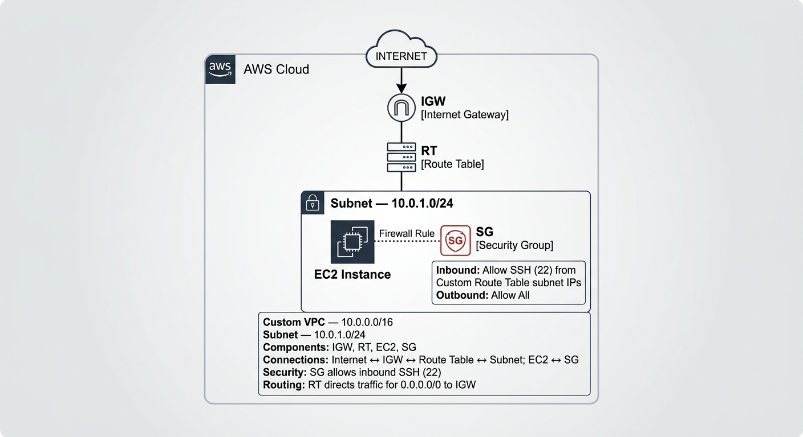
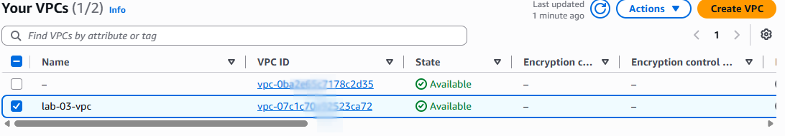
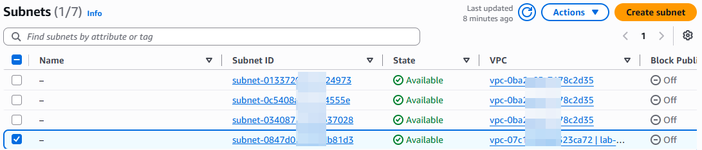
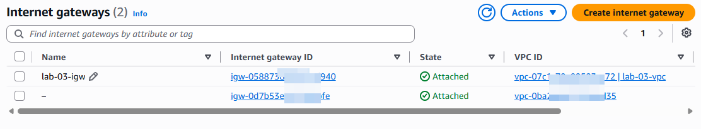
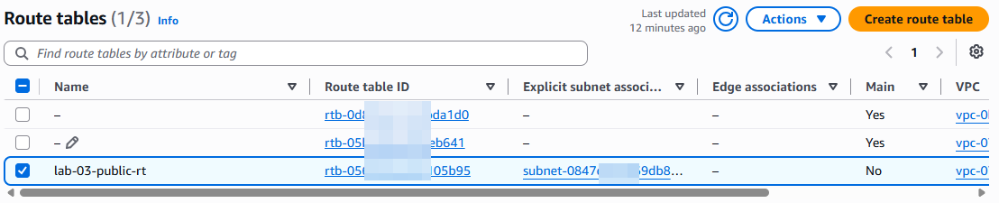
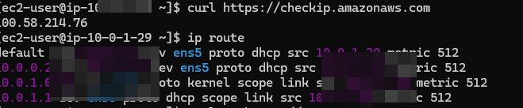
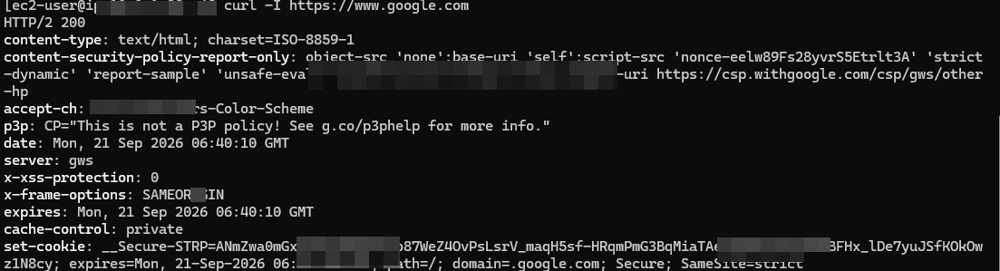

# AWS Cloud Learning Journey — Lab 03: VPC & Networking Fundamentals

## Overview

In this lab, I built a custom Amazon Virtual Private Cloud (VPC) and connected an Amazon EC2 instance to the network. The goal was to understand how AWS networking components work together to provide network connectivity and controlled access to resources.

Rather than relying on the default VPC, I configured the core components of a custom network, connected to the EC2 instance through SSH, and used Linux networking commands to examine the instance's network configuration and test connectivity.

## Objectives

- Create a custom VPC using an IPv4 CIDR block.
- Create a subnet within the VPC.
- Connect the VPC to an Internet Gateway.
- Configure a route table for internet-bound traffic.
- Launch an EC2 instance in the custom network.
- Connect to the instance through SSH.
- Inspect network interfaces and routing.
- Test network connectivity from the instance.

## AWS Services and Concepts

| Service or concept | Purpose |
|---|---|
| Amazon VPC | Provides an isolated virtual network in AWS. |
| IPv4 CIDR blocks | Define the address ranges available to the VPC and subnet. |
| Subnet | Provides a smaller network range within the VPC. |
| Internet Gateway | Enables communication between the VPC and the internet when routing and addressing are configured appropriately. |
| Route table | Determines where network traffic is directed. |
| Security Groups | Control permitted inbound and outbound traffic for associated resources. |
| Amazon EC2 | Provides the virtual machine used for connectivity tests. |
| SSH | Provides secure command-line access to the EC2 instance. |

## Network Configuration

The following address ranges were used in this lab:

| Component | Configuration |
|---|---|
| VPC IPv4 CIDR | `10.0.0.0/16` |
| Subnet IPv4 CIDR | `10.0.1.0/24` |
| Internet connectivity | Internet Gateway and route-table configuration |
| Compute resource | Amazon EC2 instance |
| Remote access | SSH |

The subnet CIDR falls within the address range of the VPC. This allows the subnet to use part of the VPC's private IPv4 address space.

## Architecture



The diagram illustrates the VPC networking components and how they work together to provide connectivity.

The diagram represents the main components used in the lab. Successful internet connectivity depends on the applicable route-table entries, subnet configuration, instance addressing, and security rules.

## Implementation Walkthrough

### 1. Create the custom VPC

I created a VPC with the CIDR block `10.0.0.0/16`. This established the private IPv4 address range for the lab network.



### 2. Create the subnet

I created a subnet using `10.0.1.0/24` within the VPC. This subnet provided the network in which I launched the EC2 instance.



### 3. Attach an Internet Gateway

I configured an Internet Gateway for the VPC. An Internet Gateway provides the VPC with a path to the internet when the route table, instance addressing, and security configuration also permit the required traffic.



### 4. Configure the route table

I configured the route table used by the subnet to support the intended network connectivity.

A route table determines the next destination for traffic. For a public subnet, a route to an Internet Gateway is necessary for internet-bound IPv4 traffic. A suitable route alone does not guarantee connectivity; the instance and security configuration must also be correct.



### 5. Launch EC2 in the custom network

I launched an EC2 instance in the custom network and reviewed its network configuration. The instance provided a practical way to test the connectivity established by the VPC, subnet, gateway, route table, and security rules.



### 6. Connect and test connectivity

I connected to the instance through SSH and ran Linux networking commands to inspect the network interfaces and routes and to test connectivity.



## Verification and Testing

The following commands can be used to inspect networking and test connectivity.

### Inspect network interfaces

```bash
ip addr
```

This displays the network interfaces and their assigned addresses.

### Inspect the routing table

```bash
ip route
```

This displays the routes available to the instance, including its default route when one is configured.

### Example: Test connectivity with curl

```bash
curl -I https://example.com
```

This can help verify HTTP connectivity to the destination. The result depends on DNS resolution, routing, security rules, and the destination's availability.

The lab also involved testing connectivity from the EC2 instance. The screenshots above document the configurations and connectivity checks performed.

## Key Lessons Learned

- A VPC provides the address space and network boundary for AWS resources.
- A subnet must use an address range contained within its VPC.
- Attaching an Internet Gateway does not automatically make every subnet public.
- A subnet's routes determine where traffic is directed.
- Internet access also depends on addressing and applicable security rules.
- SSH access requires an appropriate network path and permitted security-group traffic.
- Linux commands such as `ip addr` and `ip route` help diagnose connectivity issues.

## Troubleshooting Notes

When a connection fails, check the configuration systematically:

1. Confirm that the EC2 instance is running and attached to the intended VPC and subnet.
2. Inspect the subnet's associated route table and the routes relevant to the destination.
3. Confirm that the Internet Gateway is attached if internet connectivity is required.
4. Review the instance's addressing and the relevant security-group rules.
5. For SSH, verify the destination address, permitted SSH source, and connection details.
6. Use `ip addr` and `ip route` on the instance to investigate its local network configuration.
7. Use `curl` to test a specific destination and distinguish application-level failures from basic network configuration issues.

## Security Considerations

- Allow SSH only from a trusted source rather than opening it to everyone.
- Permit only the inbound and outbound traffic required by the lab.
- Avoid committing private keys, credentials, or other secrets to GitHub.
- Review the resources and their network exposure after testing.

## Cleanup Checklist

Before considering the lab complete, review the AWS resources created for it. When they are no longer needed:

- Terminate the EC2 instance.
- Remove lab-only network resources that are no longer needed, such as the subnet, custom route table, Internet Gateway, and VPC, observing their dependencies.
- Confirm that no unnecessary resources remain and check for any continuing charges.

Perform cleanup only after confirming that the resources are dedicated to this lab and are not being used by another project.

## Repository

The source documentation and screenshots for this learning journey are maintained in the repository:

[GitHub — AWS Cloud Learning Journey](https://github.com/Austine192-A/aws-cloud-journey)

---

*Part of my hands-on AWS Cloud Learning Journey.*