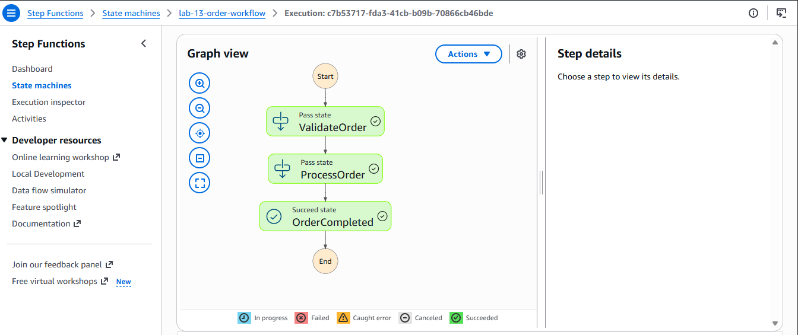
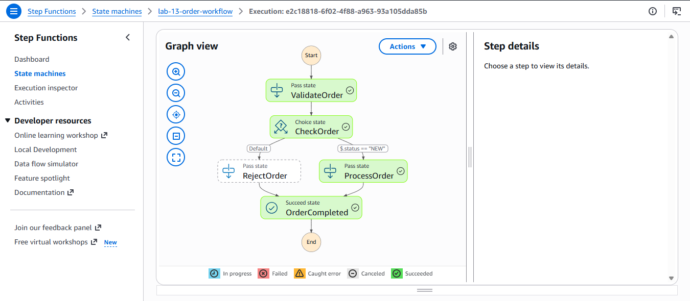
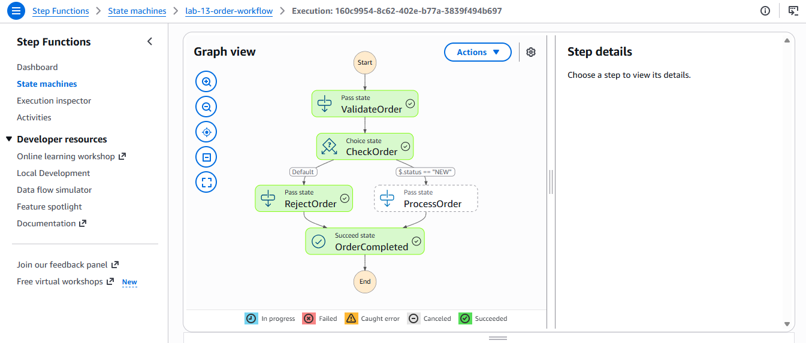
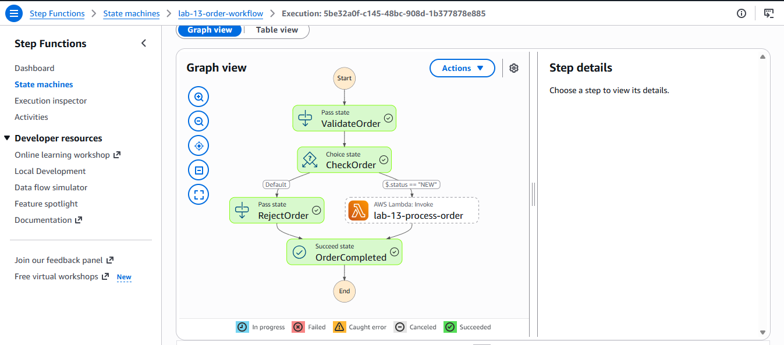
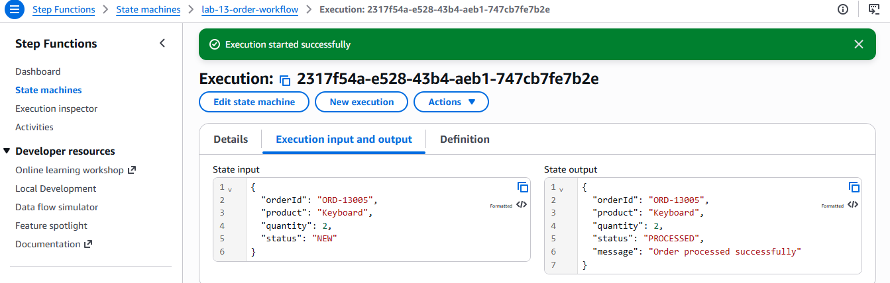
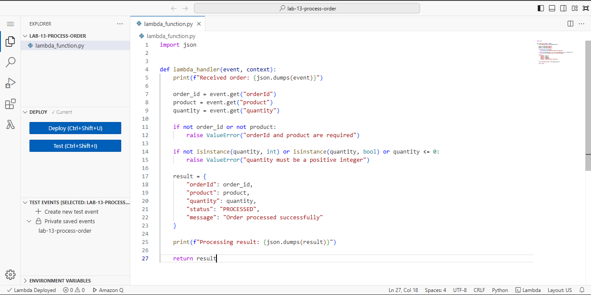

# Lab 13: AWS Step Functions Workflow Orchestration

## Overview

In this lab, I built and tested an AWS Step Functions workflow that coordinates order validation, conditional branching, and order processing through AWS Lambda.

The workflow demonstrates how Step Functions orchestrates application logic, directs execution based on input data, and invokes Lambda to process valid orders.

## Objectives

- Create an AWS Step Functions state machine.
- Implement conditional branching using a Choice state.
- Integrate AWS Lambda with Step Functions.
- Validate and process order data.
- Test valid and cancelled order paths.
- Review execution results and document the implementation.
- Clean up lab-specific AWS resources.

## AWS Services Used

- **AWS Step Functions:** Orchestrates the workflow.
- **AWS Lambda:** Validates and processes order data.
- **AWS IAM:** Provides execution permissions.
- **Amazon CloudWatch:** Supports logging and troubleshooting.

## Architecture

The workflow begins with `ValidateOrder`, then evaluates the order status in `CheckOrder`.

```text
                 Start
                   |
                   v
             ValidateOrder
                   |
                   v
               CheckOrder
                   |
          +--------+--------+
          |                 |
      Status = NEW       Default
          |                 |
          v                 v
   Lambda processing    RejectOrder
          |                 |
          +--------+--------+
                   |
                   v
             OrderCompleted
                   |
                   v
                  End
```

### Workflow behavior

- **NEW:** The Choice state routes the order to the Lambda processing task.
- **Other statuses:** The default branch routes the order to `RejectOrder`, skipping Lambda.
- **Completion:** Both paths lead to `OrderCompleted`.

The `RejectOrder` state demonstrates workflow routing. It does not persist a rejection record or update an external order system.

## Lambda Function

The Lambda function is named `lab-13-process-order`.

It:
1. Reads the order ID, product, and quantity.
2. Checks that the order ID and product are provided.
3. Validates that quantity is a positive integer.
4. Returns a result with status `PROCESSED`.
5. Writes diagnostic messages to the Lambda logs.

The Python source is available in [`lambda_function.py`](./lambda_function.py).

## Testing and Results

### 1. Initial workflow execution

The initial state machine execution was used to verify basic workflow transitions.



### 2. Valid order path

An order with status `NEW` was used to test the processing branch.



### 3. Rejected order path

An order with status `CANCELLED` followed the default branch to `RejectOrder`.



### 4. Successful execution with Lambda integration

After integrating Lambda, the workflow successfully processed a valid order.



### 5. Lambda processing output

The Lambda task returned a processing result for order `ORD-13005`.

Expected response:

```json
{
  "orderId": "ORD-13005",
  "product": "Keyboard",
  "quantity": 2,
  "status": "PROCESSED",
  "message": "Order processed successfully"
}
```



### 6. Lambda source code

The deployed Lambda function's Python implementation is documented in the AWS Console.



### Additional branch verification

After Lambda integration, order `ORD-13006` was submitted with status `CANCELLED`. The execution followed `RejectOrder`, confirming that the cancellation path remained functional.

## Key Lessons Learned

- Step Functions coordinates tasks and decisions across a workflow.
- Choice states support conditional routing based on execution input.
- Lambda can execute application logic within a Step Functions workflow.
- Both branches should be retested after state transitions change.
- IAM permissions are essential for service integration.
- Execution history and CloudWatch logs help troubleshoot failures.

## Troubleshooting

- **Unreachable state:** Check state transitions and Choice destinations.
- **Lambda invocation failure:** Verify the state machine execution role can invoke the Lambda function.
- **Lambda validation error:** Ensure the input contains `orderId`, `product`, and a positive integer `quantity`.
- **Unexpected branch:** Check the JSONPath expression and the exact `status` value.
- **Missing logs:** Review the Lambda CloudWatch log group and logging permissions.

## Cleanup

After verifying and pushing the documentation:

- Delete the Step Functions state machine after handling any remaining executions.
- Delete the Lambda function `lab-13-process-order`.
- Review and remove dedicated IAM roles created for this lab only if they are no longer needed.
- Delete lab-specific CloudWatch log groups if they are no longer needed.
- Do not delete shared VPC resources, service-linked roles, or resources belonging to other labs.

## Repository Structure

```text
13-step-functions-workflow/
├── README.md
├── lambda_function.py
└── screenshots/
    ├── 01-successful-execution.png
    ├── 02-valid-order-path.png
    ├── 03-rejected-order-path.png
    ├── 04-successful-execution.png
    ├── 05-lambda-processing-output.png
    └── 06-lambda-function-code.png
```

## Conclusion

This lab demonstrated how AWS Step Functions orchestrates conditional workflows and coordinates Lambda-based processing. It strengthened my understanding of workflow design, service integration, execution testing, IAM permissions, and cloud resource management.

**Lab 13 completed:** AWS Step Functions Workflow Orchestration.
