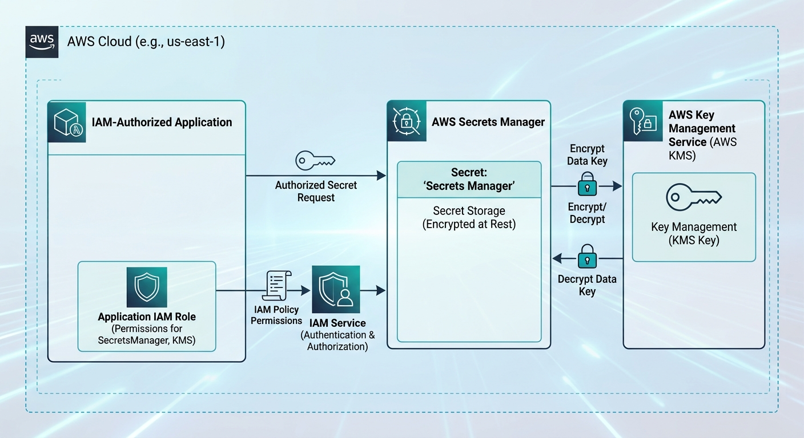
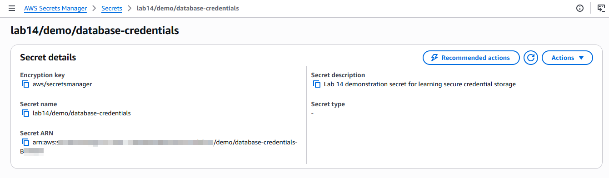
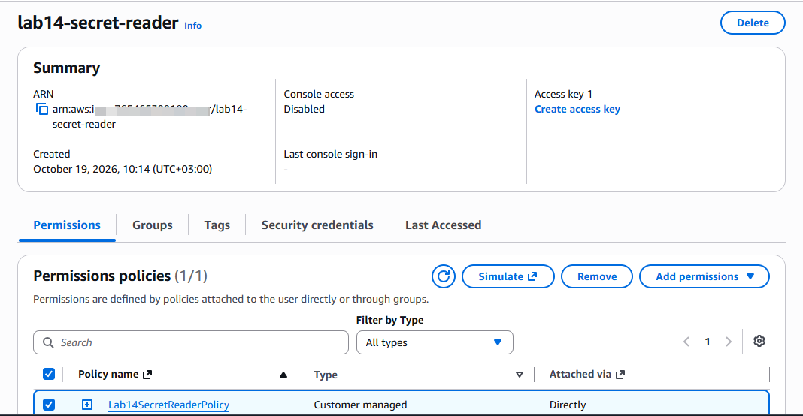
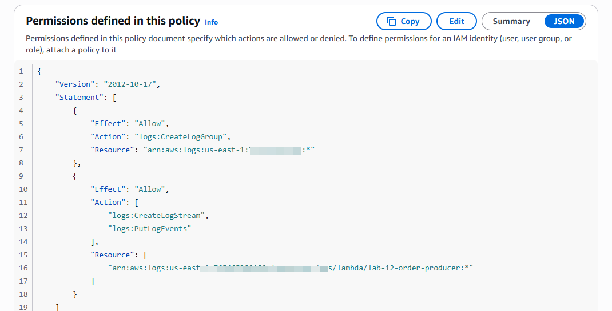
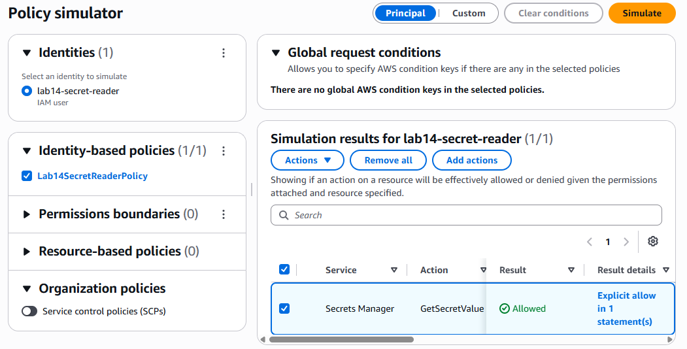

# Lab 14: AWS Security and Secrets Management

## Overview

This lab demonstrated secure credential storage and least-privilege access control using AWS Secrets Manager and AWS Identity and Access Management (IAM).

A demonstration database credential secret was created, an IAM user was configured with a narrowly scoped permissions policy, and the IAM Policy Simulator was used to verify that the requested Secrets Manager action was allowed for the specified secret.

The AWS resources were cleaned up after the lab was completed.

## Objectives

- Stored demonstration credentials in AWS Secrets Manager.
- Reviewed the encryption configuration applied to the secret.
- Created an IAM user for restricted secret access.
- Created and attached a least-privilege IAM policy.
- Verified the policy configuration and simulated the requested permission.
- Documented the architecture, configuration, and verification results.
- Cleaned up the AWS resources after testing.

## AWS Services Used

- **AWS Secrets Manager** — Stored and encrypted the demonstration secret.
- **AWS IAM** — Managed the lab user and its permissions.
- **IAM Policy Simulator** — Evaluated whether the configured policy allowed the requested action.

## Architecture

The following diagram represents the architecture used in the lab.

The lab used a dedicated IAM user and a narrowly scoped policy to control access to a specific secret stored in Secrets Manager.

## Implementation

### 1. Created a secret

A demonstration secret named `lab14/demo/database-credentials` was created in AWS Secrets Manager.

The secret contained sample database credentials and used the default AWS-managed Secrets Manager encryption key. Automatic rotation was left disabled for this demonstration.

*Figure 1: Demonstration secret and its configuration. The secret value is not shown.*

### 2. Created an IAM user

An IAM user named `lab14-secret-reader` was created without AWS Management Console access.

The user was intended to represent an application identity that required restricted access to the demonstration secret.

*Figure 2: IAM user and its attached permissions policy.*

### 3. Configured least-privilege permissions

An IAM policy named `Lab14SecretReaderPolicy` was created and attached directly to the IAM user.

The policy allowed the following action on the specific secret ARN:

- `secretsmanager:GetSecretValue`

The policy did not grant broad Secrets Manager access or administrator permissions.

*Figure 3: Policy action and resource scope for the demonstration secret.*

### 4. Verified the policy

The IAM policy JSON was reviewed to confirm that the action and resource ARN matched the intended configuration.

The IAM Policy Simulator was then used with `lab14-secret-reader` selected. The `secretsmanager:GetSecretValue` action returned **Allowed** for the specified resource.

This result verified the simulated policy evaluation. An actual secret retrieval using the IAM user's credentials was not performed.

*Figure 4: The simulator returned Allowed for the requested action and resource.*

### 5. Cleaned up resources

The AWS resources created for the lab were cleaned up after the configuration and simulation evidence had been captured.

## Key Lessons Learned

- Secrets Manager provided a dedicated service for storing sensitive application configuration.
- Encryption at rest helped protect stored secret values.
- IAM policies provided granular control over which resources an identity could access.
- Restricting a policy to a specific secret followed the principle of least privilege.
- The IAM Policy Simulator helped evaluate configured permissions without retrieving the secret.
- Verification evidence and resource cleanup were important parts of completing a cloud lab.

## Security Considerations

- Real credentials were not intended to be committed to source control.
- Secret values and AWS credentials were excluded from the published screenshots.
- The IAM policy was restricted to the intended secret rather than granting broad access.
- The policy simulation was not treated as proof of a successful live secret retrieval.
- Temporary AWS resources were cleaned up after the lab.

## Conclusion

This lab demonstrated how AWS Secrets Manager and IAM could be combined to store sensitive configuration and restrict access to a specific secret. The policy was reviewed, the requested permission was simulated successfully, the evidence was documented, and the lab resources were cleaned up.

The exercise reinforced the importance of secure secret storage, least-privilege permissions, verification, and responsible resource management in AWS.